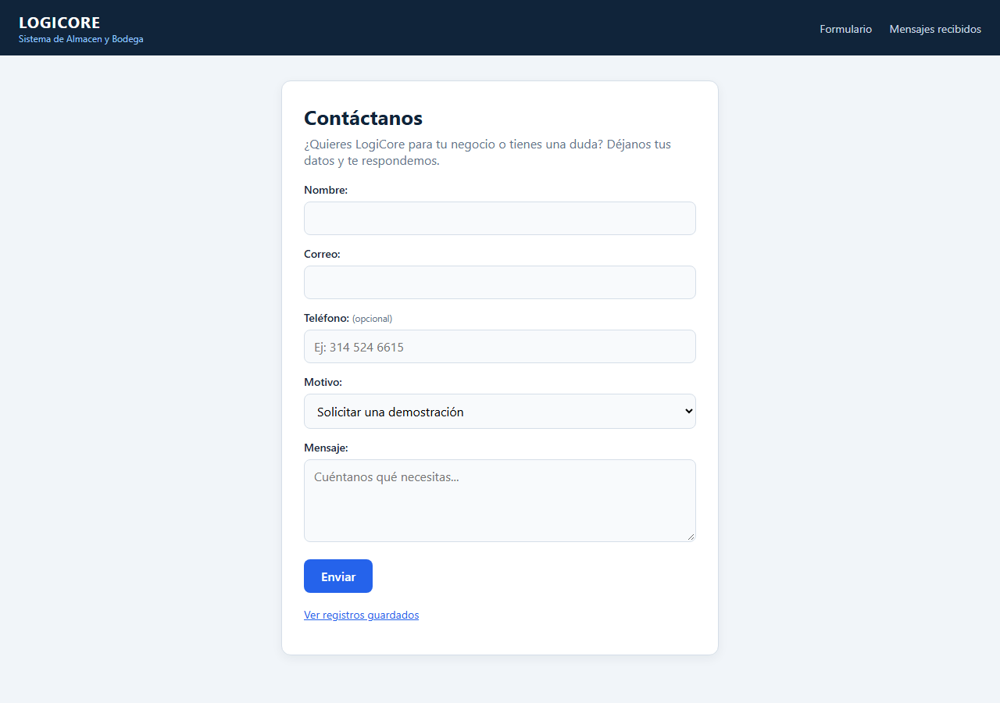
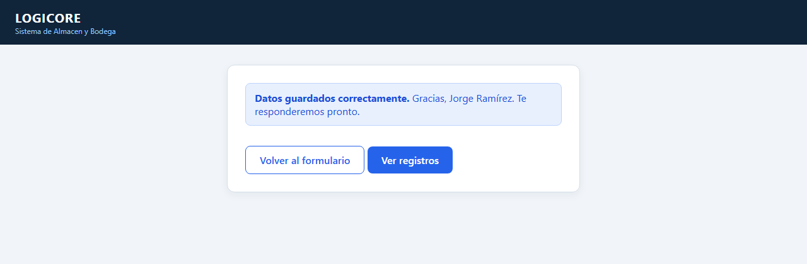
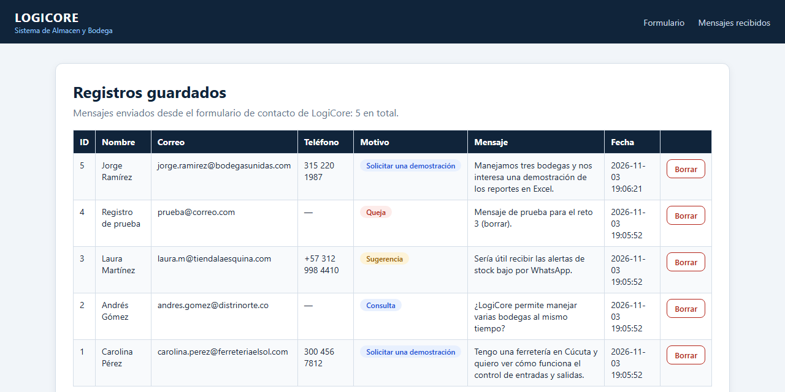
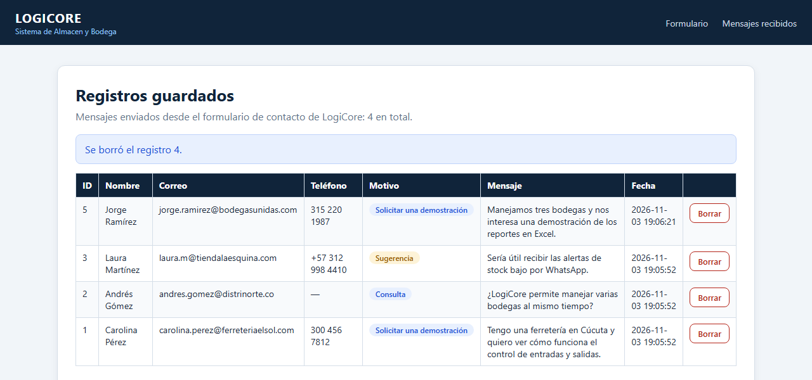
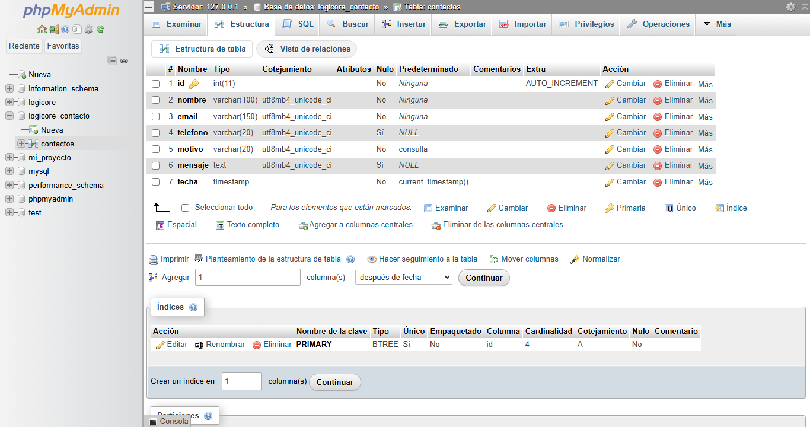
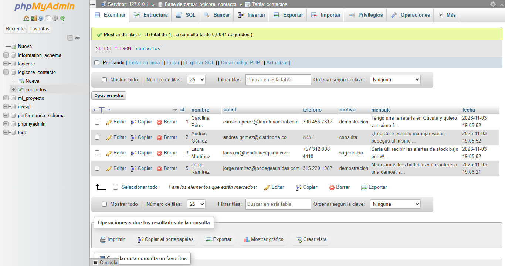

# Formulario de contacto LogiCore · PHP + MySQL

Solución de la guía **"Mi primera web con PHP y base de datos"**, aplicada a **LogiCore**, un sistema de almacén y bodega.

Es un formulario de contacto donde un negocio interesado en LogiCore deja sus datos: nombre, correo, teléfono, motivo y mensaje. PHP guarda el mensaje en MySQL y otra página muestra los mensajes en una tabla, con un botón para borrarlos.

**Autor:** Santiago Medina

## Tecnologías

XAMPP (Apache + MySQL/MariaDB) · PHP 8 con `mysqli` · HTML · CSS · Visual Studio Code

## Archivos

| Archivo | Para qué sirve |
|---|---|
| `contactos.sql` | Crea la base de datos `logicore_contacto` y la tabla `contactos` (Paso 3 y retos 1 y 2) |
| `conexion.php` | Conecta PHP con la base de datos (Paso 4) |
| `index.php` | Muestra el formulario (Paso 5) |
| `guardar.php` | Recibe los datos con `$_POST`, los valida y los guarda con una consulta preparada (Paso 6) |
| `listar.php` | Muestra los registros en una tabla y permite borrarlos (Paso 7 y reto 3) |
| `estilos.css` | Colores y diseño de LogiCore |
| `capturas/` | Evidencias del funcionamiento |

## Cómo ejecutarlo

1. Copia la carpeta `logicore_contacto` dentro de `C:\xampp\htdocs\`.
2. En el XAMPP Control Panel, pulsa **Start** en **Apache** y en **MySQL**.
3. Abre `http://localhost/phpmyadmin`, entra a la pestaña **SQL**, pega el contenido de `contactos.sql` y pulsa **Continuar**.
4. Abre `http://localhost/logicore_contacto/`.

No abras los archivos `.php` con doble clic ni con Live Server: entra siempre por `http://localhost/...`.

## Retos resueltos

- **Reto 1 ⭐: campo teléfono.** Se agregó con `ALTER TABLE`. Es opcional, pero si se escribe solo acepta números, espacios y `+`.
- **Reto 2 ⭐⭐: lista desplegable `<select>` con el motivo.** Las opciones son Solicitar una demostración, Consulta, Queja y Sugerencia. `guardar.php` comprueba que el motivo sea uno de la lista.
- **Reto 3 ⭐⭐⭐: botón para borrar un registro.** Está en `listar.php`, usa `DELETE FROM contactos WHERE id = ?` y pide confirmación antes de borrar.

## Seguridad

- **Consultas preparadas** (`prepare` + `bind_param`) para guardar y borrar, contra la inyección SQL.
- **`htmlspecialchars()`** al mostrar los datos, para que el código que alguien escriba en el formulario no se ejecute en la página.
- **Validación en el servidor:** nombre obligatorio, correo con `FILTER_VALIDATE_EMAIL`, formato del teléfono y motivo permitido.

## Capturas

**Formulario** (`index.php`)

**Datos guardados** (`guardar.php`)

**Registros guardados** (`listar.php`)

**Reto 3: registro borrado**

**Estructura de la tabla en phpMyAdmin** (con los campos `telefono` y `motivo` de los retos)

**Datos guardados en phpMyAdmin**

## Mi progreso

- [x] Instalé XAMPP y VS Code, y arranqué Apache y MySQL.
- [x] Creé la carpeta del proyecto dentro de `htdocs`.
- [x] Creé la base de datos y la tabla `contactos`.
- [x] Mi archivo `conexion.php` conecta sin errores.
- [x] Mi formulario se ve en el navegador.
- [x] Los datos se guardan en la base de datos.
- [x] Puedo ver los registros en `listar.php`.
- [x] Retos 1, 2 y 3.
